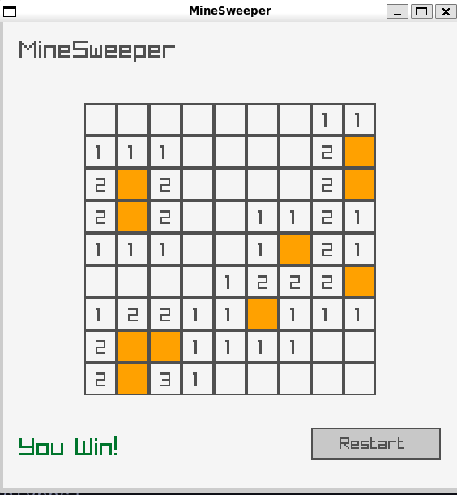

This is a Minesweeper game written in C. It's simple and just for fun.

## screenshot



## Usage

### Compile

```shell
cmake -S . -B build -DCMAKE_BUILD_TYPE=Debug
cmake --build build -j"$(nproc)"
./build/minesweeper
```
